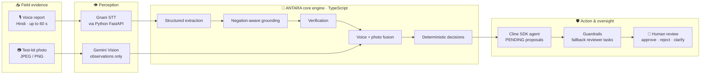
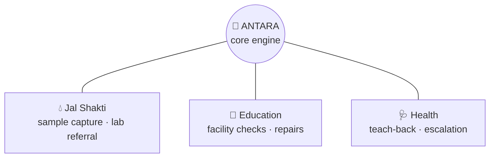
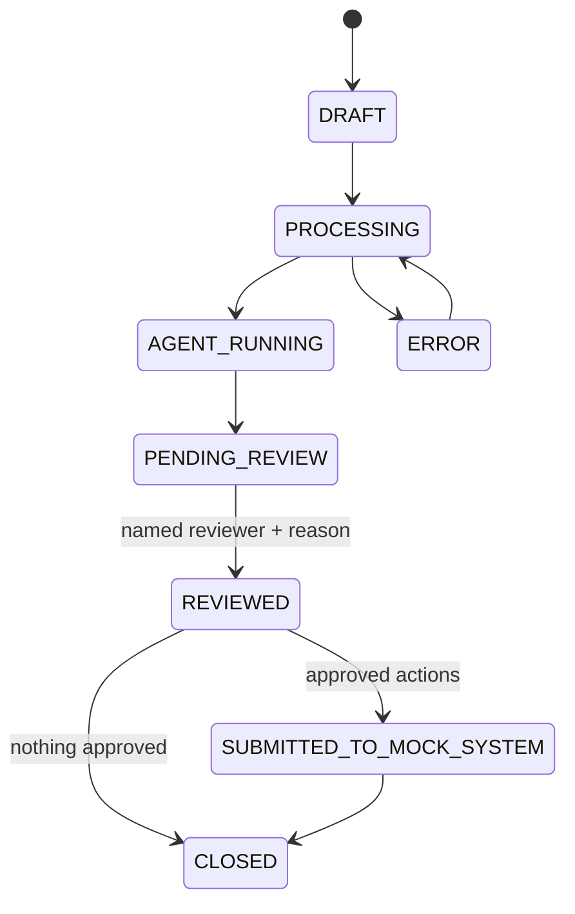
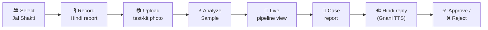

<div align="center">

# 🧬 ANTARA

### One intelligence engine. Many ministries.

**Adaptive multi-agent AI that turns multilingual field evidence into reviewable government action.**


[Overview](#-overview) · [Architecture](#-architecture) · [Quick start](#-quick-start) · [Safety](#-safety-by-design) · [Status](#-project-status)

</div>

---

## ✨ Overview

ANTARA works like the immune system's antibodies: **one shared body, specialised receptors**.
A single core engine (speech, vision, extraction, grounding, verification, decisions, human review)
adapts to each ministry through a lightweight **adapter**.

> **Flagship use case: Ministry of Jal Shakti 💧**
> A field worker speaks a report in Hindi and attaches a photo of the water-test kit.
> ANTARA transcribes the voice, analyses the photo, cross-checks both, and prepares a structured
> screening case. A named human reviewer then approves or rejects it.

| | Ministry | Use case | Status |
|:-:|---|---|:-:|
| 💧 | **Jal Shakti** | Water-test field evidence → screening case → lab referral | ✅ Prototype |
| 🏫 | **Education** | School infrastructure inspection and repair tracking | 🧪 Demo adapter |
| 🩺 | **Health & Family Welfare** | Medication-instruction comprehension (teach-back) | 🗓️ Planned |

---

## 🏗 Architecture



Voice and photo are processed **independently**, then meet at a controlled fusion step: the photo
can *corroborate* a spoken finding or *force review*, but it never overrides it.

<details>
<summary><b>🔌 How ministry adapters plug in</b></summary>



Each adapter supplies a checklist, the actions an agent may propose, privacy rules (e.g. no
wearable-video frames where minors are in view) and agent guidance. The engine stays the same.

</details>

<details>
<summary><b>📋 Case lifecycle</b></summary>



</details>

---

## 🚀 Quick start

### 🖥️ Web prototype

> Requires **Node 22+**. No API keys needed.

```powershell
powershell -ExecutionPolicy Bypass -File .\start-demo.ps1         # opens http://127.0.0.1:5173
powershell -ExecutionPolicy Bypass -File .\start-demo.ps1 -Stop   # stop the server
```

**Demo flow:**



> [!NOTE]
> **The web prototype is a scripted UI demo.**
> **Real:** your microphone recording, the photo you upload, and the spoken Hindi reply
> (generated with Gnani TTS by `backend/scripts/make_reply_audio.py`).
> **Scripted:** the displayed transcript, image observations, pipeline timing, case contents and
> review outcome. The live engine runs through the CLI below.

### ⚙️ Live engine (CLI)

<details>
<summary><b>1. Install and configure</b></summary>

```powershell
npm install
copy .env.example .env      # add GEMINI_API_KEY and GNANI_API_KEY (never commit .env)
```

</details>

<details>
<summary><b>2. Start the Python Gnani service</b> (separate terminal)</summary>

```powershell
cd backend
py -3.11 -m venv .venv
.\.venv\Scripts\python.exe -m pip install -r requirements.txt
.\.venv\Scripts\python.exe -m uvicorn antara_core.main:app --port 8000
```

</details>

<details open>
<summary><b>3. Run a Jal Shakti case (voice + photo)</b></summary>

```powershell
npm run antara -- run --domain jal_shakti --checklist field_sample_capture --language hi-IN `
  --audio report.wav --image water-test.jpeg `
  --meta source=Handpump --meta "location=Demo Village A"

npm run antara -- show <caseId>
npm run antara -- approve <caseId> <proposalId> --reviewer "Block Water Officer" --reason "..."
npm run antara -- demo      # offline end-to-end demo, no API keys
```

</details>

---

## 🛡️ Safety by design

| Principle | How ANTARA enforces it |
|---|---|
| 🚫 **No safety verdicts from photos** | A photo never establishes water safety, pH or chlorine concentration. Model output is screened for such claims and flagged for review. |
| ⚖️ **Vision never overrides voice** | A photo can corroborate a spoken finding or force review, never silently replace it. |
| ⏱️ **No invented timestamps** | Gnani returns untimed transcripts, so quotes are grounded by text only. |
| 👤 **Humans decide** | Agents create **PENDING** proposals only. Every action needs a named reviewer and a reason. |
| 🔒 **No real submissions** | Approved actions go to a mock connector; there are no government-system integrations. |
| 🧪 **Honest configuration** | Jal Shakti checklists are synthetic demo settings, not official standards. |

---

## 📁 Repository layout

```text
antara/
├── src/                    TypeScript engine
│   ├── engine/             pipeline · grounding · decisions · fusion · review · guardrails
│   ├── adapters/           jal_shakti · education · fire_safety
│   ├── cline-runtime/      Cline SDK agent + allowlisted case tools
│   ├── integrations/       Gemini · Gnani (via Python) · media (ffmpeg)
│   └── cli.ts              antara command-line interface
├── backend/                Python FastAPI service (Gnani STT · Gemini · Pydantic contracts)
├── web/                    Hackathon web prototype (static, scripted)
├── tests/                  TypeScript tests (vitest)
├── docs/                   Architecture notes, verification log, roadmap
└── start-demo.ps1          One-command demo launcher
```

---

## 🧪 Tests

```powershell
npm test                                            # TypeScript · vitest
npx tsc --noEmit                                    # type-check
cd backend; .\.venv\Scripts\python.exe -m pytest    # Python · pytest
```

All suites run **offline with mocked providers**; no paid API calls.

---

## 🧰 Tech stack

| Layer | Technology |
|---|---|
| Core engine | TypeScript · Node 22 · Zod |
| Agent orchestration | Cline SDK (`@cline/sdk`) |
| Speech | Gnani Speech APIs (STT `stt/v3`, TTS `timbre-v2.5`) |
| Vision & reasoning | Google Gemini (`gemini-3.8-flash`) |
| Service layer | Python 3.11 · FastAPI · Pydantic · httpx |
| Media | ffmpeg |

---

## 📊 Project status

| Component | Status |
|---|:-:|
| Gnani STT via Python service, called from TypeScript | ✅ Verified live |
| Gnani TTS (Hindi reply audio) | ✅ Verified live |
| Voice + independent photo pipeline | ✅ Implemented · tested offline |
| Live Cline agent | 🟡 Wired; deterministic fallback without provider credentials |
| Gemini live calls | 🟡 Verified earlier; currently timing out from the dev machine |
| Web UI connected to the live engine | 🔜 Next (prototype is scripted) |
| Health ministry adapter | 🗓️ Planned |

<div align="center">

---

**ANTARA** · Built for Indian public-sector field workflows · Human oversight at every step

</div>
